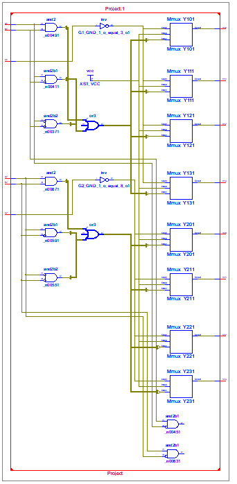
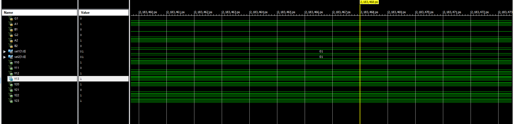
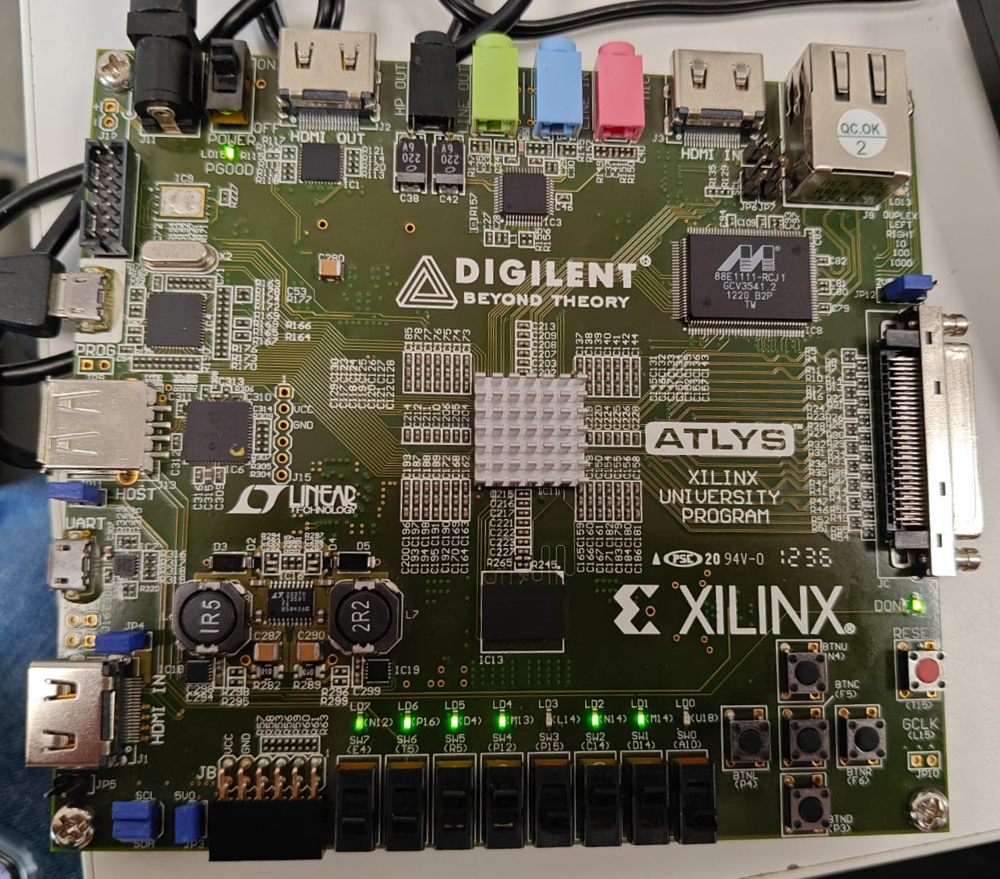

# Dual 2-to-4 Decoder / Demultiplexer on FPGA

A Verilog HDL implementation of a dual 2-to-4 line decoder / demultiplexer functionally modeled after the standard 74x139 (SN74LS139A) TTL integrated circuit, synthesized and implemented on a Xilinx Spartan-6 FPGA.

---

## Overview

The circuit implements two independent 2-to-4 line decoders with active-LOW enable inputs and active-LOW outputs. When enabled, each decoder converts a 2-bit binary select input into an active-LOW assertion on one of four output lines. When disabled, all four outputs remain HIGH. By applying data to the enable line and addresses to the select lines, each section can alternatively operate as a 1-to-4 demultiplexer.

The design was modeled in Verilog HDL, verified via behavioral simulation in Xilinx ISim, synthesized using Xilinx XST, and mapped to physical hardware on a Digilent Atlys FPGA board via Xilinx ISE 14.7.

---

## Hardware & Tools

- **Logic Specification:** 74x139 (SN74LS139A) dual 2-to-4 decoder / demultiplexer
- **Hardware Description Language:** Verilog HDL (IEEE 1364)
- **EDA Tool:** Xilinx ISE Design Suite 14.7
- **Synthesis Tool:** Xilinx XST P.20131013
- **Simulation Tool:** Xilinx ISim
- **Target FPGA:** Xilinx Spartan-6 XC6SLX45 (Speed Grade: -3, Package: CSG324)
- **Development Board:** Digilent Atlys Spartan-6 FPGA Trainer Board

---

## Design Description

The module contains two identical decoders:
- **Decoder 1:** Enable `G1` (active-LOW), Select lines `A1` (LSB) and `B1` (MSB), Outputs `Y10`, `Y11`, `Y12`, `Y13` (active-LOW).
- **Decoder 2:** Enable `G2` (active-LOW), Select lines `A2` (LSB) and `B2` (MSB), Outputs `Y20`, `Y21`, `Y22`, `Y23` (active-LOW).

```
         +---------------------+
  G1 ----|                     |---- Y10
  A1 ----|      Decoder 1      |---- Y11
  B1 ----|      (74x139-1)     |---- Y12
         |                     |---- Y13
         +---------------------+
  G2 ----|                     |---- Y20
  A2 ----|      Decoder 2      |---- Y21
  B2 ----|      (74x139-2)     |---- Y22
         |                     |---- Y23
         +---------------------+
```

### Function Table
| Enable (`G`) | Select (`B`, MSB) | Select (`A`, LSB) | `Y0` | `Y1` | `Y2` | `Y3` | State |
| :---: | :---: | :---: | :---: | :---: | :---: | :---: | :--- |
| `1` | `X` | `X` | `1` | `1` | `1` | `1` | Disabled (All outputs HIGH) |
| `0` | `0` | `0` | `0` | `1` | `1` | `1` | Line 0 selected |
| `0` | `0` | `1` | `1` | `0` | `1` | `1` | Line 1 selected |
| `0` | `1` | `0` | `1` | `1` | `0` | `1` | Line 2 selected |
| `0` | `1` | `1` | `1` | `1` | `1` | `0` | Line 3 selected |

For detailed functional specifications and demultiplexer operation, refer to [docs/truth-table.md](docs/truth-table.md).

### RTL Schematic
The RTL schematic generated by XST synthesis maps the behavioral case statements into internal logic multiplexers and gates:



---

## Pin Constraints & Hardware Mapping

The circuit I/O was mapped to onboard slide switches and LEDs of the Digilent Atlys board via `constraints/project.ucf`:

| Signal | Direction | FPGA Pin (LOC) | Board Peripherals | Function |
| :--- | :---: | :---: | :--- | :--- |
| `G1` | Input | `A10` | Slide Switch `SW0` | Decoder 1 Active-LOW Enable |
| `A1` | Input | `D14` | Slide Switch `SW1` | Decoder 1 Select Line A |
| `B1` | Input | `C14` | Slide Switch `SW2` | Decoder 1 Select Line B |
| `Y10` | Output | `U18` | LED `LD0` | Decoder 1 Output Line 0 |
| `Y11` | Output | `M14` | LED `LD1` | Decoder 1 Output Line 1 |
| `Y12` | Output | `N14` | LED `LD2` | Decoder 1 Output Line 2 |
| `Y13` | Output | `L14` | LED `LD3` | Decoder 1 Output Line 3 |
| `G2` | Input | `P15` | Slide Switch `SW3` | Decoder 2 Active-LOW Enable |
| `A2` | Input | `P12` | Slide Switch `SW4` | Decoder 2 Select Line A |
| `B2` | Input | `R5` | Slide Switch `SW5` | Decoder 2 Select Line B |
| `Y20` | Output | `M13` | LED `LD4` | Decoder 2 Output Line 0 |
| `Y21` | Output | `D4` | LED `LD5` | Decoder 2 Output Line 1 |
| `Y22` | Output | `P16` | LED `LD6` | Decoder 2 Output Line 2 |
| `Y23` | Output | `N12` | LED `LD7` | Decoder 2 Output Line 3 |

---

## Simulation

Behavioral simulation was conducted using Xilinx ISim. Stimulus values were applied to verify active-low enable suppression and proper line selection:



As shown in the waveform:
- With `G1 = 0`, `B1 = 0`, and `A1 = 1` (`sel1 = 2'b01`), line `Y11` transitions to `0` while `Y10`, `Y12`, and `Y13` remain `1`.
- With `G2 = 0`, `B2 = 0`, and `A2 = 1` (`sel2 = 2'b01`), line `Y21` transitions to `0` while `Y20`, `Y22`, and `Y23` remain `1`.

---

## FPGA Implementation & Hardware Verification

The design completed translation, mapping, place-and-route, and bitstream generation with **0 errors and 0 warnings**. The configuration bitstream was generated and programmed to the Spartan-6 XC6SLX45 device:



On the physical board:
- Inputs are set using slide switches `SW0`-`SW5`.
- Outputs are observed on LEDs `LD0`-`LD7`.
- The `DONE` status LED illuminates green upon successful FPGA bitstream configuration.

### Device Utilization Summary
Source: `Project_map.mrp` (Target: `xc6slx45-3csg324`)

| Resource | Used | Available | Utilization |
| :--- | :---: | :---: | :---: |
| **Slice Registers** | 0 | 54,576 | 0% |
| **Slice LUTs** | 4 | 27,288 | < 1% |
| **Occupied Slices** | 4 | 6,822 | < 1% |
| **Bonded IOBs** | 14 | 218 | 6% |
| **LOCed Pin Constraints** | 14 | 14 | 100% |

For complete implementation and static timing reports, see:
- [Implementation Summary](results/implementation-summary.md)
- [Timing Summary](results/timing-summary.md)

---

## Repository Structure

```
Dual-2-to-4-Decoder-FPGA/
│
├── README.md                      # Project documentation and results overview
├── .gitignore                     # Git ignore rules for Xilinx ISE builds
├── src/
│   └── Project.v                  # Verilog HDL source code
├── constraints/
│   └── project.ucf                # User Constraints File (pin mappings)
├── docs/
│   └── truth-table.md             # Functional truth table and specifications
└── results/
    ├── implementation-summary.md  # Detailed Map, PAR, and utilization report
    ├── timing-summary.md          # Static timing analysis and delay summary
    └── screenshots/               # Verified evidence images
        ├── rtl-schematic.png      # XST synthesized RTL schematic
        ├── simulation-waveform.png# ISim functional simulation waveform
        └── fpga-hardware.png      # Board-level hardware test photo
```
